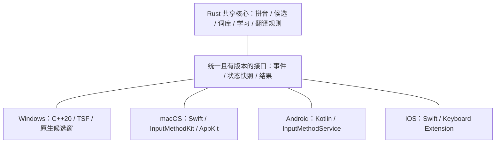

# 架构与安全边界

更新：2026-10-21。状态：设计基线；Rust 核心与 Windows 独立后台 / TSF 已部分实现，实际边界见 [实施规格](IMPLEMENTATION.md) 与测试报告。

## 分层

核心库不依赖窗口句柄、TSF / COM 对象、Android Context 或 Apple 视图对象。UI 和网络完成通知转换为明确事件；核心输出状态与操作建议，平台层负责在正确的输入上下文中编辑和上屏。

## 共享内容与平台内容

| 模块 | 共享职责 | 平台职责 |
| --- | --- | --- |
| 拼音引擎 | 切分、索引查询、候选排序、用户学习 | 按键 / 触控转换、系统输入模式与组合文本 |
| 数据 | 词库格式、版本、转换校验、用户词条语义 | 安全目录、文件锁、原子替换、迁移和设备备份规则 |
| 翻译 | 提示词、请求合并、缓存、超时状态、结果归属 | HTTP / TLS 传输实现、系统网络权限、取消与生命周期 |
| 安全配置 | 配置格式与版本、脱敏错误 | Windows DPAPI、Apple Keychain、Android Keystore 等系统设施；具体存取与共享能力须验证 |
| UI | 候选视图数据、状态命名、视觉规范 | 绘制、布局、焦点、输入法无界面模式、触控和无障碍 |

## Windows 基线

- C++20 接入层按 Windows 官方 TSF / COM 接口独立实现；只承担必要的按键判定、组合文本、上屏、生命周期和窗口协调。
- 独立输入服务承载 Rust 共享引擎，Windows SDK 传输宿主使用 C++20，见 [ADR-0002](decisions/0002-windows-broker.md)；翻译任务与按键通路隔离，联网工作在单独后台进程执行，不能让网络锁影响中文输入。
- IPC 使用有版本、有限长、可取消且有时限的本机协议；Windows 优先命名管道，校验连接方和 ACL，不能为了 AppContainer 兼容放开为所有用户可写。
- 本地组合状态支撑按键判定。主线程不能等待网络，后台 IPC 不能在回调中形成无界同步等待。
- 输入事件有序处理，禁止把按键按翻译任务的“只保留最新”规则丢弃。后台故障后的已消费按键、组合保留、取消和恢复策略必须在接入原型中明确并验证。
- 候选窗以轻量原生实现为基线，当前为 Win32 / GDI；设置原型采用 C++20 / Win32 原生控件，见 [ADR-0004](decisions/0004-windows-settings-prototype.md)，不依赖额外 UI 运行时。后续视觉升级另行验证；不能把大型 UI 运行时直接加载到所有宿主的 TSF DLL 中。
- 候选窗具体进程位置由焦点、层级、权限与 UILess 兼容性原型决定，不预设“全部 UI 外移就一定更可靠”。联网任务隔离原则不随此选择改变。
- 同时规划 x64 和 x86 TSF 组件，以覆盖 64 位系统上的 32 位应用；ARM64 单列编译与验收，不以编译成功冒充可用性。

## macOS 与移动端

- macOS 使用 Swift / InputMethodKit 接入，AppKit 候选窗与 SwiftUI 设置；组态归属输入控制器生命周期，Swift 不直接持有失效的核心借用指针。
- Android 使用 Kotlin / InputMethodService，原生 View 或 Compose 承载界面；通过受控 JNI 边界调用 Rust 库，处理服务重建、旋转和编辑器连接变化。
- iOS 使用 Swift / UIInputViewController 键盘扩展，UIKit 承载并按需组合 SwiftUI，宿主设置应用使用 SwiftUI。
- 共享核心以可嵌入库交付，桌面可以进程承载，移动端按系统服务 / 扩展生命周期加载；不依赖 Python 解释器、本地常驻 HTTP 服务或桌面 helper 才能输入。
- iOS 的网络、App Group、Keychain 共享、扩展内存和生命周期限制需单独验证；未获网络权限时只提供中文。安全输入框和禁止第三方键盘的应用按系统行为处理。
- 密钥和个人词库不因“共享核心”自动同步到其他设备。手机触控、横竖屏及数字 / 邮箱 / 密码输入类型分别适配。

## 接口与并发约束

1. 对外接口采用稳定的 C ABI / JNI 或等价的版本化协议；不跨语言暴露 Rust 容器、C++ STL 或未经定义所有权的裸指针。
2. 明确字符串编码、长度、光标偏移含义、分配 / 释放责任和错误返回；UTF-8、UTF-16、Unicode 标量及用户可见字符的边界不能互相假定相等。
3. 每个组合有唯一身份和递增版本；编辑结果绑定创建时的原始系统输入上下文，不能稍后重新查“当前焦点窗口”就上屏。
4. COM / UI 对象留在平台允许的线程。Rust panic、C++ 异常不能穿过 ABI 或系统回调边界。
5. 不在持有引擎锁、IPC 锁时调用系统 UI / COM；回调不得与工作线程同步互等。
6. 取消后确认后台工作及 I/O 已结束再回收对象；避免 detached 任务捕获失效的实例地址。
7. 明确队列、任务、线程、文本、响应和缓存预算；超限、失败、重连不能无声丢字、重放已提交文字或自动重发投递结果不明的远端请求。
8. 学习记录与配置采用可恢复写入，损坏和版本迁移有边界；卸载 / 升级不能顺便删除用户数据。

## 规划模块

下面是未来源码的责任划分，不代表这些目录 / Cargo 项目已经创建。

| 规划模块 | 职责 |
| --- | --- |
| `core/input` | 组合状态、拼音解析、候选生成与排序 |
| `core/dictionary` | 词库编译、查询、校验、用户学习 |
| `core/translation` | 请求规则、提示词版本、缓存与结果有效性 |
| `bindings` | 有版本的 C ABI、JNI、协议定义与测试 |
| `platforms/windows` | TSF、候选窗、后台进程、设置与安装 |
| `platforms/macos` | IMK、原生 UI 与签名 / 公证 |
| `platforms/android` | IME 服务、键盘、设置与包签名 |
| `platforms/ios` | 键盘扩展、宿主设置应用、权限与分发 |

## 旧项目经验

历史问题涉及全局锁与 UI 互等、慢管道拖住服务、异步对象失效、COM 引用关系、共享可变响应被后续按键覆盖等。它们作为风险模型和新测试用例的来源，不能据此直接复制旧实现，也不能宣称 Rust 会消除所有同类问题。
