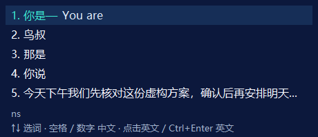

# 截图反馈与紧凑候选框

2026-10-23。用户反馈行内候选版仍不符合预期，并提供两张实际软件截图。第一张仍为拼音及“中文、英文、双语”三个提交行；第二张已为逐行中文、选中行英文，但760×324逻辑像素窗口的宽度、行距和留白明显过大。本轮按截图修正紧凑布局，不将上一版自动检查或远端CI成功记为用户验收通过。

## 实现

- 保持完整中文候选；仅选中中文行附英文，不恢复独立英文/双语行。
- 固定尺寸改为460×198逻辑像素，候选行高28、五行可见，主体字体16、底部拼音和提示13。较上一版窗口面积减少约63%；选中变化和译文返回均不调整窗口尺寸。
- 长译文在选中行内滚动；绘制、鼠标命中、滚轮和无障碍行矩形共享相同紧凑几何。英文滚轮步长小于视口、相邻视图有重叠，避免紧凑行仍沿用原32像素步长而跳过文字。底部和不可见区域不能选中被遮挡的候选。
- 输入操作维持数字/空格提交中文，方向键或鼠标选择待翻译中文，点击英文或Ctrl+Enter提交英文；未开启翻译时点击中文仍直接提交。
- 不在更新时强制结束用户软件。Windows输入法模块可被应用保留在内存，磁盘上的新DLL并不替换运行中的映射。第一张截图确认为旧界面；本机进程元数据与旧模块保留相符，但启动时间/模块路径本身不能证明具体内存版本。

## 验证状态

定向x64原生展示检查通过：32次等待/就绪循环、一次原生定位/显示、无隐藏，包含长英文滚动和紧凑区命中边界。六张固定虚构内容DPI预览已生成，96DPI短/长译文图片均人工查看。图片不包含用户截图、实际输入或真实模型输出。

只读模块元数据补充：本机Notepad++映像大小454656，与保留的旧x86 DLL相符，不匹配更新后的x86文件；ChatGPT映像大小581632，与行内版x64文件相符。结合两张截图，可以解释不同软件同时出现旧/新布局；大小匹配不能区分同大小构建，也不替代新进程实际输入。

完整检查 `artifacts/p1/20261023-152934-185/`，scope=all、x64/x86，74/74退出0，107源/数据哈希与56个直接产物快照；两架构各46个Rust单元和6个真实词表集成通过。两架构原生展示均为32个等待/就绪循环、一次定位/显示、无隐藏、49次完整绘制（包含16次英文滚轮绘制），六种DPI/长短译文预览通过。默认TSF、数字、翻页、混输、个人词、混写、UILess和10秒原生资源均通过；不是新的一次8小时或真实应用输入验收。

预览包 `artifacts/delivery/20261023-153757-160/TransInput-0.1.0-preview-windows.zip`，SHA256 `c3f7391ee1cc7cbeb0e42a0ddff5472d8a6f18fdd1dce1ae682121cf6d7715c6`。包为完整构建；本机实际只更新两个TIP DLL，其余已安装组件保持原字节。

工作区回滚夹具 `artifacts/compact-candidates/rollback-20261023-153758-170/` 在两个DLL置换后故意拒绝保护路径验证，原39文件和安装标记全部恢复，无残留暂存/日志/备份；未触碰实际安装。

本机更新 `artifacts/tip-update/20261023-153805-731/`：41文件（含供仍运行软件使用的旧映射备份）校验通过，实际系统注册COM核对与独立进程TSF激活两架构通过。安装Verify `artifacts/installation/20261023-153806-798/` 成功。新TIP SHA256：

- x64：`4ed9ea8569c90826714802d384e0c54eef56f97c39d77c9d8e40ad7a1ebbd698`
- x86：`04c116e97e4ba15ab4bd25b1e3fe3745d24a4c13a905207dfe4475d01cc2ced6`

DPAPI设置与加密个人备份哈希不变；未改注册/默认输入法/微软拼音/开始菜单/策略，不强制关闭用户软件。没有自动向DeepSeek发送新测试文本，没有读取或输出Key，仓库保持私有。已请用户完全退出并重开Notepad++复验；上一版实际体验验收未通过，本轮实际软件输入与闪烁尚待反馈。

中间检查 `artifacts/p1/20261023-152200-552/` 主动停止：完整验证过程中复核发现英文滚轮仍按旧行高步进，修正后重跑。该轮部分成功不能算完整通过，原日志和停止原因保留；只停止此次自有验证进程树，没有结束用户软件。
