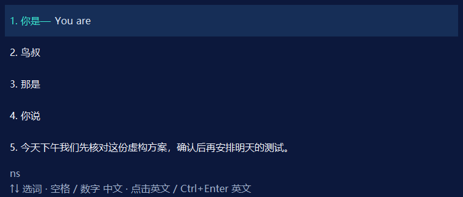

# 逐行中文候选与行内英文

用户复验前次闪烁修复后仍有闪烁，并明确交互应为逐行 `1.你是 — 英文 / 2.鸟叔 / 3.那是 / 4.你说`。以最终逐行选择为准，撤销最初横向一栏的理解；示例词只作为外观样例，不硬编码词库排序。

## 当前修改

- 中文候选列表始终保留完整一页，英文只附在选中的中文同一行。其他行显示中文，原独立英文和双语候选取消。实际文字上屏与展示标签分离，TSF UILess列表也保留中文序号与选中行英文。
- 翻译开启时，↑↓/点击中文切换高亮并请求当前中文的英文；空格或数字1–9上屏中文，点击行内英文或Ctrl+Enter上屏英文。未就绪Ctrl+Enter只保留组合，不把回车送给宿主意外提交，不提交旧英文。翻译关闭时保留中文点击直接上屏。
- 英文上屏继续检查当前原文、组合和版本、输入类型、焦点及只读状态。选择切换用只读会话复核输入类型，不为选中状态重写同一拼音；英文不参与中文学习。
- 窗口固定760×324逻辑像素，每行52，五行可见，其余中文可用↑↓、滚轮或数字选择。单行、九行、无候选、等待英文及长英文使用相同窗口尺寸。小工作区按可用尺寸限幅。
- 长英文在选中行右侧换行，鼠标移到该英文区域滚轮可看全文；中文区滚轮查看其他候选。不再动态显示/隐藏原生滚动条，也不因英文变长撑高窗口。
- 窗口定位改为本次组合的起点，避免每个拼音字符把整窗向右移动；宿主移动/布局变化仍重新读取。起点滚出可见范围时回退到活动光标；排版暂未完成保持已有帧。
- 相同后台状态不再重复发布UI或请求重绘，保留整帧内存绘制和40ms空候选中间帧合并。

## 验证范围

新增/修改测试覆盖：中文列表不消失、数字2仍选择第二中文、方向键和鼠标改变实际翻译原文、切词/等待结果不写宿主文档、Ctrl+Enter和鼠标英文、旧结果/旧按下失效、只读/敏感输入、英文不学习、分页翻译、UILess标签与相同轮询不重发布。

原生离屏窗口探针交替零/一/九候选、不同选中行及短/长英文，检查窗口矩形恒定、首次之外无原生重新定位/显示、命中中文/英文区域正确、延迟帧取消。96/144/192 DPI分别生成短英文与长英文末尾的PNG并检查。仅本项目进程和固定虚构数据，不发送真实DeepSeek请求，不自动操作其他软件。

实际宿主改善需安装后重新打开应用复验；此前用户报告的持续闪烁保持失败记录，不能以原生探针通过取代。

## 本轮结果

- 完整双架构 `artifacts/p1/20261023-150313-756/`，scope=all，74/74；107源/数据和56直接产物快照。各46 Rust单元与6正式词表集成通过。数字中文、鼠标/方向选词后翻译、英文上屏、旧结果拒绝、学习隔离、分页、混输和UILess新断言均在本轮执行。
- 新包 `artifacts/delivery/20261023-151158-668/TransInput-0.1.0-preview-windows.zip`，SHA256 `4213d5ea14d15fb1509afed203da65cdca2edf1b88c0ea144abc26d55174b4ac`。
- 更新回滚夹具 `artifacts/inline-candidates/update-rollback-result.json`：在工作区故意让替换后的验证失败，原37文件和marker恢复，不修改真实安装。
- 本机只更新x64/x86两个TIP DLL，证据 `artifacts/tip-update/20261023-151227-325/`；x64 SHA256 `a26768afdb5f3432e0ec0305a02cce52847f9f7d5d93c42dd153085975e8761f`，x86 `4831e8fc38d0a8463a851e7b6d63e611bfe2ad7859ea96ec0850c904f311b18a`。其余已安装组件保留，39文件含旧DLL备份核对通过。两架构独立进程实际系统TSF激活与安装Verify `artifacts/installation/20261023-151229-449/` 通过。
- DPAPI设置和加密备份更新前后哈希不变；未修改默认输入法/微软拼音/开始菜单/策略，不强行关闭用户进程。旧DLL按原SHA保留供已打开进程使用，需重开软件才加载新布局。没有重复上午19项卸载/重装，不冒称已测真实应用输入。
- 已请求用户按新布局测试ns、切换中文和英文上屏并复验闪烁；本轮真实输入结果待反馈，仓库保持私有。

固定虚构布局样例（实际候选由词库和个人排序决定）：

