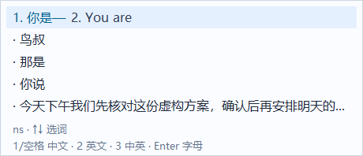

# 数字输出快捷键

用户在Shift/浅色/TI实际复验通过后，进一步明确：1或空格选当前中文，2英文，3中英，Enter提交输入字母。本轮保留浅色逐行布局、Shift切换和TI标识，仅调整翻译模式的输出动作及对应提示。此前Shift/TI记录仍有效，不继承为新数字快捷键已验收。

## 行为

- 翻译模式下1/空格提交当前选中中文，2提交对应英文，3一次提交“中文 英文”（中间一个空格），Enter提交原始拼音；数字小键盘1/2/3同样支持，Shift符号/应用快捷键仍按原规则处理。
- 中文候选使用方向键/鼠标切换，选中行标为1、英文前标为2，其他中文用圆点，避免显示“2.某中文”但按2却提交英文。底部显示1/空格中文、2英文、3中英、Enter字母；不恢复三个独立输出行。
- 翻译模式中0/4–9作为数字文字边界；未启用翻译或敏感输入下仍为普通中文序号。2/3仅在当前中文原文、组合版本、焦点、可写性、译文状态均有效时提交；等待/失效不会提交空文本、旧译文或意外触发宿主动作。
- 英文/中英输出不加入中文学习记录；Ctrl+Enter及点击英文保留兼容，中文、英文和双语均通过原上下文一次写入。

## 验证与安装结果

最新完整检查 `artifacts/p1/20261023-162955-475/` 双架构74/74通过，冻结108个构建相关源码/数据和56个直接产物/PNG。各架构46个Rust单元测试和6个真实词表集成测试通过；TSF检查包含1/2/3、Enter原拼音、切换候选后2、小键盘2、数字4文字边界、等待/过期/只读保护和中英不学习。Shift组合键、失焦、按键重复和有序混输回归也通过。自动检查不请求真实DeepSeek，实际接口正常使用由用户输入触发。

已用最新检查点打包，预览ZIP SHA256为 `564f49db883e19137c741d8f23f82ad964bdf363e30d006436a16039c2c9a453`。本机更新 `artifacts/tip-update/20261023-164020-540/` 置换x64/x86的TIP DLL和注册助手，共四文件；49个安装文件（含仍可能被旧进程映射的历史备份）核对通过。独立进程系统COM/TSF激活两架构通过，安装Verify记录为 `artifacts/installation/20261023-164022-081/`。更新回滚夹具在四文件置换后恢复原45文件及marker；实机配置密文与加密备份哈希保持一致，没有更改默认输入法或添加开始菜单入口。

已打开新的Windows记事本进行系统安装版实际输入复验，用户对“1或空格→中文、2→英文、3→中文 英文、Enter→原始输入字母”回复 **“四种输出都正常”**，记录于 `artifacts/numeric-output/user-acceptance.json`。此前Shift、浅色和TI实际验收仍有效。本次反馈只覆盖所述交互，不扩大为所有应用、长时压力或公开发布批准；仓库继续私有。
